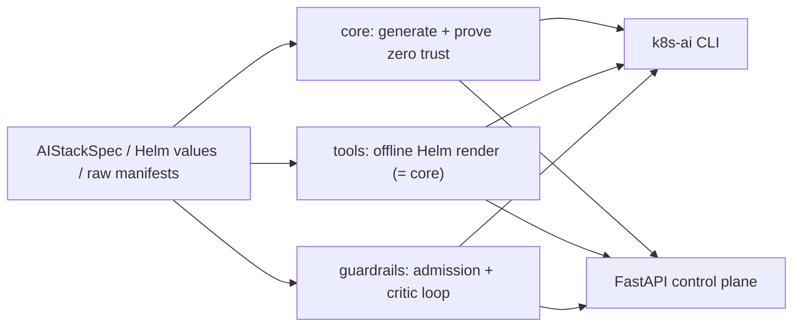

# cloud-native-k8s-ai

[](https://github.com/mikeZ98/cloud-native-k8s-ai/actions/workflows/ci.yml)
[](pyproject.toml)
[](pyproject.toml)
[](pyproject.toml)
[](.github/workflows/ci.yml)
[](docs/architecture.md#4-the-zero-trust-invariant)
[](LICENSE)

**Production Kubernetes for AI microservices, zero trust by construction.** One typed spec
of a FastAPI inference API, a Qdrant vector store, a Redis job broker and KEDA queue
autoscaling compiles into manifests whose every network flow is proven against a declared
intent; a Helm chart renders the very same objects; an admission engine judges any
manifest from any source and repairs what it safely can. All of it runs offline: no
cluster, no cloud account, no network in the tests.

## Why it is different

- **Proved, not linted.** `compile_ai_stack` evaluates NetworkPolicy semantics over every
  workload plus adversarial probes (intruder pods, cross-namespace look-alikes, the
  Internet) and refuses to emit a bundle unless the reachable flows equal the intent:
  [the zero-trust invariant](docs/architecture.md#4-the-zero-trust-invariant).
- **One source of truth.** The Helm chart is rendered by an in-process Go-template engine
  and must match the generator object for object, down to scalar types and list order.
- **Admission with remediation.** 45 violation codes across workload security, zero-trust
  networking and autoscaling safety; a critic loop applies RFC 6902 fixes until stable and
  never widens access.
- **Attacked on purpose.** 41 adversarial vectors (privilege escalation, label spoofing,
  poisoned default-deny, CIDR wildcards, host namespaces) and 9 YAML bombs are denied in
  the test suite; Hypothesis checks the invariant on generated stacks across the valid
  input space. Writing those tests found and fixed five real defects.



Deep dives: [architecture](docs/architecture.md) (topology matrix, formal invariant,
critic loop, KEDA loop) · [security model](docs/security_model.md) (threat matrix, code
catalog, Kyverno/OPA parity, benchmarks).

## Quickstart

Requirements: [uv](https://docs.astral.sh/uv/) (it installs CPython 3.12). On macOS with
the external-SSD layout of this repository, also `direnv` (see [CONTRIBUTING](CONTRIBUTING.md)).

```bash
git clone https://github.com/mikeZ98/cloud-native-k8s-ai && cd cloud-native-k8s-ai
direnv allow          # optional: pins caches under ./.cache and isolates KUBECONFIG
uv sync --locked
```

### CLI

```bash
uv run k8s-ai spec -o stack.yaml                   # reference spec (the chart defaults)
uv run k8s-ai compile stack.yaml -o manifests.yaml # 15 objects, zero trust proved
uv run k8s-ai compile stack.yaml --format json     # same bundle as structured JSON
uv run k8s-ai admit manifests.yaml --spec stack.yaml   # exit 0 admitted, 1 denied
uv run k8s-ai admit broken.yaml --remediate -o fixed.yaml
uv run k8s-ai chart lint --values prod-values.yaml # schema, contracts, parity, zero trust
uv run k8s-ai chart render --namespace ai-system -o rendered.yaml   # helm template, offline
```

Exit codes: `0` admitted (ALLOW or WARN) or lint clean, `1` denied or lint findings,
`2` invalid input. Untrusted YAML is screened for aliases and deep nesting first.

### Helm

The chart in [`deploy/helm/cloud-native-k8s-ai`](deploy/helm/cloud-native-k8s-ai) is
validated offline by `k8s-ai chart lint`. To deploy it you need a real `helm`, a cluster
whose CNI enforces NetworkPolicy, the KEDA CRDs (or `autoscaling.enabled=false`) and an
ingress controller in `ingress-nginx`:

```bash
helm lint deploy/helm/cloud-native-k8s-ai
helm template ai deploy/helm/cloud-native-k8s-ai --namespace ai-system
helm install ai deploy/helm/cloud-native-k8s-ai --namespace ai-system --create-namespace \
  -f prod-values.yaml
```

Inside this repository direnv points `KUBECONFIG` at an empty file on purpose; deploy
from a shell outside it or pass `--kubeconfig`. The chart deploys the inference image
`ghcr.io/mikez98/inference-api`, built elsewhere: **this repository ships no Dockerfile
or container image**. The control plane below runs as a Python process.

### Control plane (FastAPI)

```bash
uv run k8s-ai serve --port 8000        # or: uvicorn --factory cloud_native_k8s_ai.api:create_app
curl -s localhost:8000/readyz          # chart, schemas, generator, guardrails, chartLint
uv run python -c 'import json,sys,yaml; print(json.dumps(yaml.safe_load(sys.stdin)))' \
  < stack.yaml > stack.json
curl -s 'localhost:8000/api/v1/compile?format=yaml' -H 'content-type: application/json' \
  --data-binary @stack.json
curl -s 'localhost:8000/api/v1/validate/admission?remediate=true' \
  -H 'content-type: application/yaml' --data-binary @manifests.yaml
curl -sN localhost:8000/api/v1/stream/compile   # Server-Sent Events, one per manifest
```

| Endpoint | Purpose |
|---|---|
| `GET /healthz`, `GET /readyz`, `GET /metrics` | liveness, readiness self-checks, Prometheus |
| `POST /api/v1/compile` | spec → bundle (JSON, or YAML via `?format=yaml` / `Accept`) |
| `GET`, `POST /api/v1/stream/compile` | stream the bundle as Server-Sent Events |
| `POST /api/v1/validate/chart` | lint a Helm values overlay |
| `POST /api/v1/validate/topology` | run the zero-trust topology solver on manifests |
| `POST /api/v1/validate/admission` | admission guardrails, optional critic loop |

Errors are RFC 7807 `application/problem+json` with the request's `X-Request-ID`;
OpenAPI is served at `/docs`.

## Security & admission guardrail runbook

**Gate every deployment.** Run `k8s-ai admit manifests.yaml --spec stack.yaml` in CI (or
`POST /api/v1/validate/admission`). `--spec` makes the guardrails trust exactly your
stack's ingress and KEDA namespaces and identify the API and Qdrant by their exact
selectors. A non-zero exit blocks the pipeline.

**Read a denial.** Each violation has a stable `code`, the object, a JSON-pointer `path`
and a `remediation` of kind `patch`, `create` or `manual`. Look the code up in the
[catalog](docs/security_model.md#5-violation-code-catalog); `WARN` never blocks, `DENY`
always does.

**Repair.** `k8s-ai admit … --remediate -o fixed.yaml` applies every automatic fix
(hardened `securityContext`, removed open rules and untrusted peers, created default-deny
and DNS policies, Qdrant locked to the API, safe KEDA cooldown) and reports what is left.
Review the diff, then fix the manual items:

| Code | Do this |
|---|---|
| `image-latest-tag`, `image-untagged` | pin a version tag or, better, a `sha256` digest |
| `best-effort-container`, `missing-resource-*` | declare cpu and memory requests and limits |
| `workload-selector-overlap` | give the workload unique `app.kubernetes.io/name` + `component` labels; treat as a possible impersonation attempt |
| `keda-exceeds-quota` | lower `maxReplicaCount` to the value in the advice, or raise the quota |
| `keda-threshold-*`, `keda-replica-bounds` | fix the trigger targets and replica range |

**Change network rules safely.** NetworkPolicies are derived from
`AIStackGenerator.intent()`; change the intent, the generator and the chart template
together, then run `k8s-ai chart lint`. Any reachable flow the intent does not declare
fails compilation.

**Operate the control plane.** `/readyz` returns 503 with the failed check named
(`chart`, `schemas`, `generator`, `guardrails`, `chartLint`) or `draining` during
shutdown. Alert on `validations_total{outcome="deny"}` spikes (someone is pushing
non-compliant manifests), `manifest_compilations_total{outcome="failure"}`, HTTP 5xx in
`http_requests_total` and `manifest_streams_total{outcome="aborted"}`.

## Quality gates

Every push and pull request runs [`.github/workflows/ci.yml`](.github/workflows/ci.yml):
static analysis, then the hermetic test suite, plus a full-history attribution audit.
Actions are pinned by commit SHA, the token is read-only, dependencies come from the
hash-locked `uv.lock`, and pytest disables sockets.

```bash
uv run ruff check . && uv run ruff format --check .
uv run mypy                          # --strict
uv run bandit -c pyproject.toml -r src
uv run yamllint --strict .
uv run pytest                        # ~1.1k tests, 100% branch coverage enforced
scripts/audit-attribution.sh --history-only
HYPOTHESIS_PROFILE=deep uv run pytest tests/test_deep_eval.py   # long fuzzing run
```

## Repository layout

| Path | Contents |
|---|---|
| [`src/cloud_native_k8s_ai/schemas`](src/cloud_native_k8s_ai/schemas) | strict Pydantic v2 contracts (Kubernetes, KEDA, NetworkPolicy, Terraform) |
| [`src/cloud_native_k8s_ai/core`](src/cloud_native_k8s_ai/core) | generator, topology solver, autoscaling resolver, YAML engine |
| [`src/cloud_native_k8s_ai/tools`](src/cloud_native_k8s_ai/tools) | offline Go-template engine and Helm tooling |
| [`src/cloud_native_k8s_ai/guardrails`](src/cloud_native_k8s_ai/guardrails) | admission guardrails, code catalog, critic loop |
| [`src/cloud_native_k8s_ai/api`](src/cloud_native_k8s_ai/api) | FastAPI control plane |
| [`src/cloud_native_k8s_ai/cli.py`](src/cloud_native_k8s_ai/cli.py) | `k8s-ai` command line |
| [`deploy/helm/cloud-native-k8s-ai`](deploy/helm/cloud-native-k8s-ai) | Helm chart with strict `values.schema.json` |
| [`tests`](tests) | unit, contract, chart, API, guardrail, adversarial, property-based, concurrency and docs tests |
| [`docs`](docs) | architecture and security model |

## Contributing

Single-maintainer repository with an enforced attribution policy, conventional commits
and fast-forward-only merges: see [CONTRIBUTING.md](CONTRIBUTING.md).

## License

[MIT](LICENSE)
