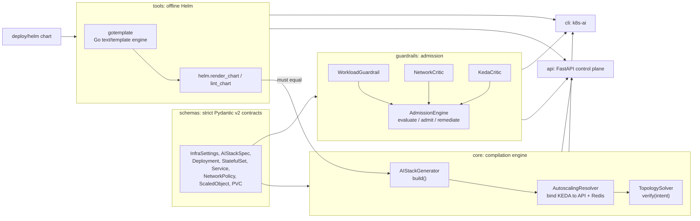
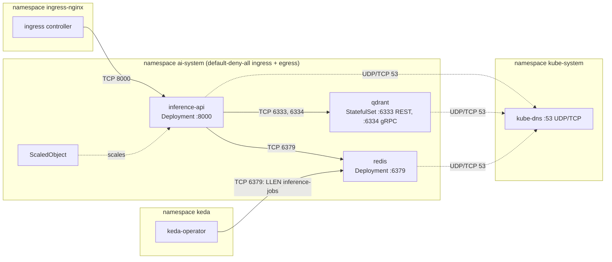
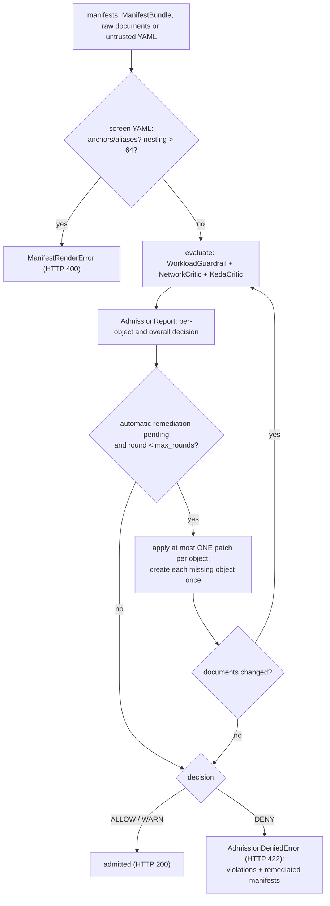
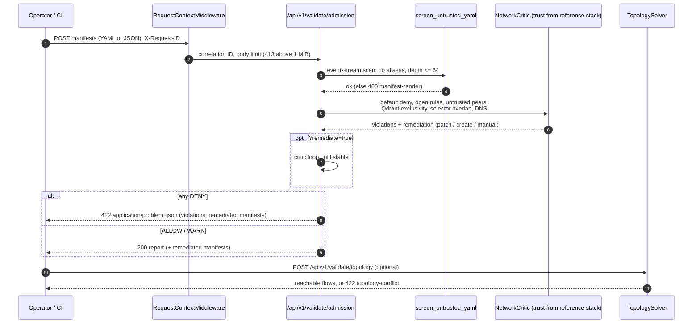
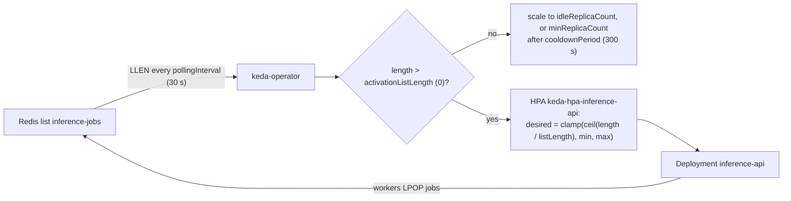

# Architecture

`cloud-native-k8s-ai` turns one typed description of an AI microservice stack (FastAPI
inference API, Qdrant vector store, Redis job broker, KEDA queue autoscaling) into
Kubernetes manifests that are **zero trust by construction**, and keeps them that way: the
same contracts drive a Helm chart, an admission engine with auto-remediation, a CLI and an
HTTP control plane. Everything runs in-process; nothing here needs a cluster.

- [1. Components](#1-components)
- [2. Deployed topology](#2-deployed-topology)
- [3. Topology matrix](#3-topology-matrix)
- [4. The zero-trust invariant](#4-the-zero-trust-invariant)
- [5. Admission control critic loop](#5-admission-control-critic-loop)
- [6. Zero-trust flow interception](#6-zero-trust-flow-interception)
- [7. KEDA scaling loop](#7-keda-scaling-loop)
- [8. Control plane and observability](#8-control-plane-and-observability)
- [9. Module map](#9-module-map)

Security details (threats, the violation-code catalog, Kyverno/OPA parity, benchmarks)
live in [security_model.md](security_model.md).

## 1. Components



| Layer | Guarantee |
|---|---|
| `schemas` | Strict, frozen models: quantities, names, CIDRs, ports and images validated in their exact Kubernetes spelling; `:latest`, root, writable root filesystems and privilege escalation are unrepresentable. |
| `core` | `compile_ai_stack` refuses to return a bundle that fails the topology solver or the autoscaling resolver. |
| `tools` | The Helm chart is rendered offline by a Go-template engine with Helm's value semantics and must reproduce the core bundle object for object. |
| `guardrails` | Untyped manifests from anywhere are judged like an admission webhook would, with remediation advice and an automatic critic loop. |
| `api`, `cli` | Thin, hermetic front ends over the same functions. |

## 2. Deployed topology



Six NetworkPolicies implement it: `default-deny-all`, `allow-dns-egress`,
`qdrant-allow-from-app`, `inference-api-allow-ingress`, `inference-api-allow-egress` and
`redis-allow-ingress`. Selectors are the immutable pair
`app.kubernetes.io/name` + `app.kubernetes.io/component`.

## 3. Topology matrix

The solver probes every managed workload together with synthetic endpoints: `kube-dns`,
`keda-operator`, `ingress-controller`, an in-namespace `intruder` wearing the API's
component label, cross-namespace look-alikes (`mimic-*`) carrying the exact selector
labels of each workload, and an Internet host (`203.0.113.10`, TEST-NET-3). It tries
26 protocol/port pairs: every declared port, the DNS port and sentinel ports
(1, 22, 80, 443, 3306, 5432, 6335, 8080, 9090, 65535) over TCP and UDP.

Result for the reference stack (the chart's default values): exactly these flows are
reachable, nothing else.

| source ↓ / destination → | inference-api | qdrant | redis | kube-dns |
|---|---|---|---|---|
| ingress-controller | TCP/8000 | — | — | — |
| inference-api | — | TCP/6333, TCP/6334 | TCP/6379 | TCP/53, UDP/53 |
| qdrant | — | — | — | TCP/53, UDP/53 |
| redis | — | — | — | TCP/53, UDP/53 |
| keda-operator | — | — | TCP/6379 | — |
| intruder | — | — | — | TCP/53, UDP/53 |
| mimic-inference-api | — | — | — | — |
| mimic-qdrant | — | — | — | — |
| mimic-redis | — | — | — | — |
| internet | — | — | — | — |

The same set as solver output (kept in sync with the code by `tests/test_docs.py`):

<!-- reachable:begin -->
```text
inference-api -> kube-dns TCP/53
inference-api -> kube-dns UDP/53
inference-api -> qdrant TCP/6333
inference-api -> qdrant TCP/6334
inference-api -> redis TCP/6379
ingress-controller -> inference-api TCP/8000
intruder -> kube-dns TCP/53
intruder -> kube-dns UDP/53
keda-operator -> redis TCP/6379
qdrant -> kube-dns TCP/53
qdrant -> kube-dns UDP/53
redis -> kube-dns TCP/53
redis -> kube-dns UDP/53
```
<!-- reachable:end -->

The `intruder` reaching DNS is intended: `allow-dns-egress` admits every pod of the
namespace, and name resolution is the only flow a stranger pod gets.

## 4. The zero-trust invariant

### 4.1 Model

Let

- $E = W \cup P$ be the endpoints: managed workloads $W$ and synthetic probes $P$;
- $\mathcal{P}$ the NetworkPolicies, each with namespace $ns(p)$, pod selector $\sigma(p)$,
  types $\tau(p) \subseteq \{\mathrm{In}, \mathrm{Eg}\}$ and rule lists $I(p)$, $O(p)$;
- $\Pi$ the probed protocol/port pairs; $G$ the governed namespaces (those holding $W$).

Selection and isolation, for a direction $d \in \{\mathrm{In}, \mathrm{Eg}\}$:

$$\mathrm{sel}(p, e) \iff ns(p) = ns(e) \land \sigma(p) \models \mathrm{labels}(e)$$

$$\mathrm{iso}_d(e) \iff \exists p \in \mathcal{P} : \mathrm{sel}(p, e) \land d \in \tau(p)$$

A rule $r$ admits a peer and a port when one of its peers matches (pod selector and
namespace selector, defaulting to the policy's own namespace; or an `ipBlock` containing
the address minus its `except` blocks) and one of its ports matches (no ports means all
ports; named ports resolve against the destination's container ports; `endPort` ranges):

$$\mathrm{in}(s, e, \pi) \iff \lnot\mathrm{pod}(e) \lor \lnot\mathrm{iso}_{\mathrm{In}}(e) \lor \exists p, \exists r \in I(p) : \mathrm{sel}(p, e) \land \mathrm{peer}(r, s, p) \land \mathrm{port}(r, e, \pi)$$

$$\mathrm{eg}(s, e, \pi) \iff \lnot\mathrm{iso}_{\mathrm{Eg}}(s) \lor \exists p, \exists r \in O(p) : \mathrm{sel}(p, s) \land \mathrm{peer}(r, e, p) \land \mathrm{port}(r, e, \pi)$$

Policies are additive (a union of rules), and a connection needs both sides:

$$\mathrm{reach}(s, e, \pi) \iff \mathrm{eg}(s, e, \pi) \land \mathrm{in}(s, e, \pi)$$

The reachability relation over the probe universe is

$$R = \{ (s, e, \pi) \in E \times E \times \Pi \mid s \neq e \land (ns(s) \in G \lor ns(e) \in G) \land \mathrm{reach}(s, e, \pi) \}$$

### 4.2 Intent

`AIStackGenerator.intent()` derives, from the spec alone, a relation of *required* flows
$\mathrm{Req}$, a relation of *permitted* flows $\mathrm{Perm}$, exclusive-ingress
constraints $X = \{(t, S_t, K_t)\}$ (target, allowed sources, allowed ports) and the DNS
clients $C$:

| Relation | Reference stack |
|---|---|
| $\mathrm{Req}$ | ingress-controller→API TCP/8000; API→Qdrant TCP/6333, TCP/6334; API→Redis TCP/6379; keda-operator→Redis TCP/6379 |
| $\mathrm{Perm}$ | every namespace pod (API, Qdrant, Redis, intruder) → kube-dns, UDP/53 and TCP/53 |
| $X$ | Qdrant only from {API} on {6333, 6334}; Redis only from {API, keda-operator} on {6379}; API only from {ingress-controller} on {8000} |
| $C$ | {API} |

### 4.3 Invariant

The topology is zero trust, $\mathrm{ZT}$, iff all of the following hold:

1. **No missing flow:** $\mathrm{Req} \subseteq R$.
2. **No unintended flow:** $R \subseteq \mathrm{Req} \cup \mathrm{Perm}$.
3. **Default deny:** $\forall n \in G\ \exists p : ns(p) = n \land \sigma(p) = \varnothing \land \tau(p) = \{\mathrm{In}, \mathrm{Eg}\} \land I(p) = O(p) = \varnothing$.
4. **Total isolation:** $\forall w \in W, \forall d : \mathrm{iso}_d(w)$.
5. **Exclusive ingress:** $\forall (t, S, K) \in X$:
   $\{(s, \pi) \mid s \neq t \land \mathrm{in}(s, t, \pi)\} \subseteq S \times K$ and $S \times K \subseteq \{(s, \pi) \mid \mathrm{in}(s, t, \pi)\}$.
6. **Resolvable names:** $\forall c \in C, \forall \pi \in \{\mathrm{UDP}/53, \mathrm{TCP}/53\} : \mathrm{reach}(c, \text{kube-dns}, \pi)$.

Conditions 1 and 2 pin $R$ between two bounds,
$\mathrm{Req} \subseteq R \subseteq \mathrm{Req} \cup \mathrm{Perm}$; for the reference
stack both bounds are met with equality ($|R| = |\mathrm{Req} \cup \mathrm{Perm}| = 5 + 8 = 13$).
Condition 5 is checked on ingress alone, so it holds even if a future egress rule were
too broad. `compile_ai_stack` raises `TopologyConflictError` unless $\mathrm{ZT}$ holds,
and `tests/test_deep_eval.py` checks $\mathrm{ZT}$ on Hypothesis-generated stacks across
the whole valid input space.

## 5. Admission control critic loop

The guardrails judge **raw** documents (the typed models would refuse to parse much of
what admission must catch). Each violation carries a remediation: an RFC 6902 patch, a
new object, or manual steps. The critic loop applies the automatic ones and re-evaluates.



Formally, with $V(D)$ the violations of document set $D$ and $\mathrm{fix}(D)$ the result
of applying the first automatic remediation per object plus every pending create:

$$D_0 = D, \qquad D_{k+1} = \mathrm{fix}(D_k), \qquad \text{stop at the first } k \text{ with } D_{k+1} = D_k \text{ or } k = 16.$$

The loop *converges* when no automatic remediation remains in $V(D_k)$; manual ones
(unpinned images, missing resource limits, scaling thresholds, selector overlaps) stay in
the final report. One patch per object per round keeps every JSON pointer valid: two
removals in one rule list would otherwise shift each other's indices.

## 6. Zero-trust flow interception

How a NetworkPolicy change is intercepted before it reaches a cluster, through the
control plane (the CLI runs the same functions in-process):



## 7. KEDA scaling loop



`core.desired_replicas` models what KEDA and the HPA converge to, for queue length $q$:

$$\mathrm{replicas}(q) = \begin{cases} \mathrm{idle} \text{ if set, else } \mathrm{min} & q \le \mathrm{activation} \\ \max(\mathrm{min}, 1, \min(\lceil q / \mathrm{listLength} \rceil, \mathrm{max})) & \text{otherwise} \end{cases}$$

For the reference policy (listLength 5, activation 0, min 1, max 10):

| queue length | 0 | 1 | 5 | 6 | 23 | 50 | 51 | 1000 |
|---|---|---|---|---|---|---|---|---|
| replicas | 1 | 1 | 1 | 2 | 5 | 10 | 10 | 10 |

Safety conditions enforced by the resolver and the `autoscaling` guardrail:
$\mathrm{min} \le \mathrm{max}$; $\mathrm{idle} < \mathrm{min}$;
$\mathrm{cooldown} \ge \mathrm{polling}$ (otherwise scale-down acts on unsampled
metrics and thrashes); positive targets; one autoscaler per workload; and, with a
ResourceQuota $Q$, the worst case
$\sum_{w} \mathrm{replicas}_{\max}(w) \cdot \mathrm{perPod}(w) \le Q$.

## 8. Control plane and observability

`k8s-ai serve` (or `uvicorn --factory cloud_native_k8s_ai.api:create_app`) runs:

| Endpoint | Purpose |
|---|---|
| `GET /healthz` | liveness |
| `GET /readyz` | readiness: chart loads, defaults satisfy schema + contracts, reference stack compiles zero trust and passes admission, chart lints clean |
| `GET /metrics` | Prometheus exposition |
| `POST /api/v1/compile` | spec → bundle (JSON, or YAML via `?format=yaml` / `Accept`) |
| `GET`, `POST /api/v1/stream/compile` | Server-Sent Events, one `manifest` event per document, then `complete` |
| `POST /api/v1/validate/chart` | lint a Helm values overlay |
| `POST /api/v1/validate/topology` | topology solver on submitted manifests |
| `POST /api/v1/validate/admission` | admission guardrails, `?remediate=true` for the critic loop |

Every error is an RFC 7807 `application/problem+json` response carrying the request's
`X-Request-ID`. Metrics (per app instance registry): `http_requests_total`,
`http_request_duration_seconds`, `http_requests_in_flight` (labelled by route
template), `manifest_compilations_total`, `manifest_compile_duration_seconds`,
`manifest_documents_total`, `validations_total{target,outcome}`,
`manifest_streams_total{outcome}`, `control_plane_build_info`, plus process and GC
collectors.

## 9. Module map

| Path | Role |
|---|---|
| `src/cloud_native_k8s_ai/schemas/` | contracts: cluster, storage, network, KEDA, Terraform, settings |
| `src/cloud_native_k8s_ai/core/generator.py` | `AIStackGenerator`, `ManifestBundle`, YAML engine, untrusted-YAML screening |
| `src/cloud_native_k8s_ai/core/topology.py` | NetworkPolicy evaluator and `TopologySolver` |
| `src/cloud_native_k8s_ai/core/autoscaler.py` | KEDA binding, policy checks, `desired_replicas` |
| `src/cloud_native_k8s_ai/tools/gotemplate.py` | Go `text/template` + Sprig subset with Helm value semantics |
| `src/cloud_native_k8s_ai/tools/helm.py` | chart loading, values validation, rendering, lint and core parity |
| `src/cloud_native_k8s_ai/guardrails/` | catalog, workload/network/KEDA guardrails, remediation, engine |
| `src/cloud_native_k8s_ai/api/` | FastAPI app, routes, middleware, problems, telemetry |
| `src/cloud_native_k8s_ai/evals/` | seeded perturbation engine, evaluator, benchmark reports |
| `src/cloud_native_k8s_ai/cli.py` | `k8s-ai` command line |
| `deploy/helm/cloud-native-k8s-ai/` | production Helm chart (renders exactly the core bundle) |
| `tests/` | hermetic suites: unit, contract, chart, API, guardrails, adversarial, property-based, concurrency, docs |
