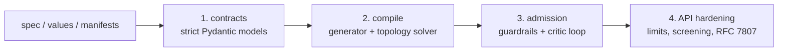

# Security model

This document states what `cloud-native-k8s-ai` defends against, how, and where its
guarantees stop. Every claim below is backed by a test: the threat matrix rows are the
vectors of `tests/test_adversarial.py`, the code catalog is
`cloud_native_k8s_ai.guardrails.CATALOG`, and `tests/test_docs.py` fails if either drifts
from this page.

- [1. Assets, actors and trust boundaries](#1-assets-actors-and-trust-boundaries)
- [2. Defense in depth](#2-defense-in-depth)
- [3. Threat matrix: 41 adversarial vectors](#3-threat-matrix-41-adversarial-vectors)
- [4. Untrusted input: YAML bombs and payload hardening](#4-untrusted-input-yaml-bombs-and-payload-hardening)
- [5. Violation code catalog](#5-violation-code-catalog)
- [6. Auto-remediation semantics](#6-auto-remediation-semantics)
- [7. Kyverno / OPA parity](#7-kyverno--opa-parity)
- [8. Benchmarks](#8-benchmarks)
- [9. Residual risks and non-goals](#9-residual-risks-and-non-goals)

## 1. Assets, actors and trust boundaries

| Asset | Why it matters |
|---|---|
| Qdrant vectors and snapshots | proprietary embeddings; exfiltration or poisoning changes model answers |
| Redis job queue | job injection or deletion; queue length also drives autoscaling (cost) |
| Inference API pods | hold model weights and credentials; the only component exposed to ingress |
| Cluster nodes | root, privileged or host-namespace pods escape to the node |

| Actor | Capability assumed |
|---|---|
| Tenant / CI author | submits arbitrary manifests and Helm values (mistakes or malice) |
| Compromised in-namespace pod | can create pods with chosen labels, open connections |
| Pod in another namespace | can copy any labels; cannot change policies in `ai-system` |
| Internet host | reaches whatever an `ipBlock` or a missing policy exposes |
| Control-plane client | sends arbitrary HTTP bodies to the API |

Trusted: the Kubernetes API server and CNI enforcing NetworkPolicy as specified, the
stack's declared ingress-controller and KEDA namespaces, and `kube-system` DNS. Identity
inside a namespace is **labels**: anything that can set the API's selector labels is the
API, which is why `workload-selector-overlap` exists.

## 2. Defense in depth

| Layer | Stops | Fails with |
|---|---|---|
| Contracts | unrepresentable states: `:latest`, root, writable root FS, escalation, bad quantities/ports/CIDRs, rules without peers | `ValidationError` → `ManifestRenderError` / 422 |
| Compilation | any reachable flow outside the intent, missing default deny, non-exclusive Qdrant/Redis/API ingress, missing DNS, bad autoscaling bounds | `TopologyConflictError`, `ResourceConstraintError` |
| Helm parity | chart drift from the generator (any field, type or list order) | `lint_chart` findings |
| Admission | everything above on **untyped** manifests from any source, plus cross-object checks (selector overlap, competing scalers, quotas) | `AdmissionDeniedError` / 422 `admission-denied` |
| API | oversized, deeply nested or alias-bombed bodies; malformed requests; leaked internals | 413 / 400 / 422 problems, opaque 500 |

## 3. Threat matrix: 41 adversarial vectors

Each vector starts from a compliant compiled bundle, is submitted as raw YAML and must be
**DENIED** with exactly the codes listed. "After remediation" is the outcome of the critic
loop: *clean* means every automatic fix applied and the result is admitted (and, when it
fits the typed models, passes the topology solver); *manual* lists what needs a human.

### Privilege escalation

| # | Vector | Detected as | After remediation |
|---|---|---|---|
| 1 | `explicit-root-user` | `run-as-non-root-not-enforced`, `run-as-root` | clean |
| 2 | `root-inherited-from-pod` | `run-as-root` | clean |
| 3 | `container-overrides-pod-nonroot` | `run-as-non-root-not-enforced` | clean |
| 4 | `sudo-setuid-escape` | `privilege-escalation-allowed` | clean |
| 5 | `escalation-left-to-default` | `privilege-escalation-allowed` | clean |
| 6 | `privileged-container` | `privileged-container` | clean |
| 7 | `cap-sys-admin` | `capabilities-added` | clean |
| 8 | `cap-prefixed-spelling` | `capabilities-added` | clean |
| 9 | `drop-lowercase-all` | `capabilities-not-dropped` | clean |
| 10 | `type-confused-booleans` | `privilege-escalation-allowed`, `run-as-non-root-not-enforced`, `writable-root-filesystem` | clean |
| 11 | `privileged-init-container` | `privileged-container` | clean |
| 12 | `debug-ephemeral-container` | `capabilities-not-dropped`, `privilege-escalation-allowed`, `privileged-container`, `writable-root-filesystem` | clean |
| 13 | `smuggled-as-pod` | `run-as-root` | clean |
| 14 | `smuggled-as-daemonset` | `run-as-root` | clean |
| 15 | `smuggled-as-job` | `run-as-root` | clean |
| 16 | `smuggled-as-cronjob` | `run-as-root` | clean |
| 17 | `smuggled-as-replicaset` | `run-as-root` | clean |

### Label spoofing / traffic impersonation

| # | Vector | Detected as | After remediation |
|---|---|---|---|
| 18 | `rogue-clone-of-api-labels` | `workload-selector-overlap` | manual: `workload-selector-overlap` |
| 19 | `rogue-superset-of-api-labels` | `workload-selector-overlap` | manual: `workload-selector-overlap` |
| 20 | `qdrant-opened-to-any-api-component` | `qdrant-ingress-not-exclusive` | clean |
| 21 | `qdrant-widened-by-match-expressions` | `qdrant-ingress-not-exclusive` | clean |
| 22 | `qdrant-reached-from-any-namespace` | `cross-namespace-ingress`, `qdrant-ingress-not-exclusive` | clean |
| 23 | `qdrant-opened-to-every-pod` | `qdrant-ingress-not-exclusive` | clean |

### Default-deny poisoning

| # | Vector | Detected as | After remediation |
|---|---|---|---|
| 24 | `default-deny-deleted` | `missing-default-deny-egress`, `missing-default-deny-ingress` | clean |
| 25 | `default-deny-selects-nobody` | `missing-default-deny-egress`, `missing-default-deny-ingress` | clean |
| 26 | `allow-all-rule-hidden-in-deny` | `ingress-from-anywhere`, `missing-default-deny-ingress`, `qdrant-ingress-not-exclusive` | clean |
| 27 | `internet-egress-hidden-in-deny` | `external-egress`, `missing-default-deny-egress` | clean |
| 28 | `egress-silently-left-open` | `missing-default-deny-egress` | clean |
| 29 | `default-deny-in-wrong-namespace` | `missing-default-deny-egress`, `missing-default-deny-ingress` | clean |

### CIDR wildcards

| # | Vector | Detected as | After remediation |
|---|---|---|---|
| 30 | `egress-ipv4-everything` | `external-egress` | clean |
| 31 | `egress-ipv6-everything` | `external-egress` | clean |
| 32 | `egress-internet-split-in-halves` | `external-egress` | clean |
| 33 | `egress-broader-than-allowed` | `external-egress` | clean |
| 34 | `egress-everything-except-private` | `external-egress` | clean |
| 35 | `egress-wildcard-string` | `external-egress` | clean |
| 36 | `egress-host-bits-trick` | `external-egress` | clean |
| 37 | `ingress-from-internet` | `external-ingress` | clean |

### Host namespaces

| # | Vector | Detected as | After remediation |
|---|---|---|---|
| 38 | `hostNetwork-escape` | `host-namespace` | clean |
| 39 | `hostPID-escape` | `host-namespace` | clean |
| 40 | `hostIPC-escape` | `host-namespace` | clean |
| 41 | `all-host-namespaces` | `host-namespace` | clean |

Further adversarial checks outside the table: API look-alikes in **another** namespace
gain nothing (policies only select their own namespace) and are not flagged as
impersonation; duplicate
keys (`runAsNonRoot: true` then `false`) are judged on the effective, last value; `sudo`
in a container command is harmless once `allowPrivilegeEscalation: false` sets
`no_new_privs`; all three host namespaces at once are removed in three rounds.

## 4. Untrusted input: YAML bombs and payload hardening

`core.screen_untrusted_yaml` walks PyYAML's iterative **event stream** before anything is
constructed: any anchor or alias is refused, and so is collection nesting deeper than
`MAX_YAML_DEPTH = 64` (PyYAML's constructor is recursive; a few kilobytes of `[[[[`
would exhaust the stack). Tests replace `yaml.safe_load_all` with a function that fails
if called, proving no bomb reaches construction.

| Bomb | Shape | Rejected because |
|---|---|---|
| `billion-laughs` | 9 levels × 9 aliases of `lol` (10⁹ nodes if expanded) | anchors and aliases |
| `quadratic-blowup` | one 10 kB scalar aliased 10,000 times | anchors and aliases |
| `anchor-only` | an anchor without alias | anchors and aliases (refused outright) |
| `alias-as-key` | alias used as a mapping key | anchors and aliases |
| `merge-key` | `<<: *base` injecting `runAsUser: 0` | anchors and aliases |
| `alias-deep-in-list` | alias hidden in a container env value | anchors and aliases |
| `flow-nesting` | 100,000 nested `[` | nesting deeper than 64 |
| `block-nesting` | 5,000 nested block mappings | nesting deeper than 64 |
| `mapping-nesting` | 1,000 nested `{a: ...}` | nesting deeper than 64 |

| Other input | Handling |
|---|---|
| `!!python/object/apply`, `!!python/name` tags | `yaml.safe_load` has no constructor for them → 400 `manifest-render`; nothing executes |
| request body > 1 MiB (`K8SAI_API_MAX_BODY_BYTES`) | 413, checked on `Content-Length` and while streaming |
| deeply nested JSON (5,000 levels) | pydantic-core recursion limit → 422 `invalid-request` |
| strict JSON contracts | parsed with `model_validate_json` (no type coercion; tuples from JSON arrays) |
| `X-Request-ID` | echoed only if it matches `[A-Za-z0-9._:-]{1,128}`, else a fresh UUID (no header injection) |
| unexpected exceptions | opaque 500 problem with the request ID; details only in the JSON log |

## 5. Violation code catalog

Every code always carries the same decision and remediation kind. Guardrails build
violations through `guardrails.catalog.violation`, which takes the decision from the
catalog and rejects unregistered codes and remediations of the wrong kind.

| Code | Guardrail | Decision | Remediation | Meaning |
|---|---|---|---|---|
| `run-as-root` | workload-security | DENY | patch | a container runs as UID 0 |
| `run-as-non-root-not-enforced` | workload-security | DENY | patch | runAsNonRoot is not true (container or pod) |
| `writable-root-filesystem` | workload-security | DENY | patch | readOnlyRootFilesystem is not true |
| `privilege-escalation-allowed` | workload-security | DENY | patch | allowPrivilegeEscalation is not false |
| `privileged-container` | workload-security | DENY | patch | privileged: true |
| `capabilities-not-dropped` | workload-security | DENY | patch | capabilities.drop does not contain ALL |
| `capabilities-added` | workload-security | DENY | patch | adds a capability outside the allow list |
| `host-namespace` | workload-security | DENY | patch | hostNetwork, hostPID or hostIPC is true |
| `best-effort-container` | workload-security | DENY | manual | no resource requests or limits at all |
| `missing-resource-requests` | workload-security | DENY | manual | cpu or memory request missing |
| `missing-resource-limits` | workload-security | DENY | manual | cpu or memory limit missing |
| `requests-exceed-limits` | workload-security | DENY | manual | a request is larger than its limit |
| `invalid-resource-quantity` | workload-security | DENY | manual | a quantity does not parse |
| `image-untagged` | workload-security | DENY | manual | image has no tag or digest (implicit :latest) |
| `image-latest-tag` | workload-security | DENY | manual | image uses the mutable :latest tag |
| `image-invalid-digest` | workload-security | DENY | manual | image digest is not sha256:<64 hex> |
| `invalid-pod-selector` | network-zero-trust | DENY | manual | a policy's podSelector is not a valid selector |
| `ingress-from-anywhere` | network-zero-trust | DENY | patch | an ingress rule has no from: every source |
| `egress-to-anywhere` | network-zero-trust | DENY | patch | an egress rule has no to: every destination |
| `external-ingress` | network-zero-trust | DENY | patch | ipBlock source outside the allow-listed CIDRs |
| `external-egress` | network-zero-trust | DENY | patch | ipBlock destination outside the allow-listed CIDRs |
| `cross-namespace-ingress` | network-zero-trust | DENY | patch | source namespace is broad or untrusted |
| `cross-namespace-egress` | network-zero-trust | DENY | patch | destination namespace is broad or untrusted |
| `invalid-peer` | network-zero-trust | DENY | patch | a peer selects nothing valid |
| `missing-default-deny-ingress` | network-zero-trust | DENY | create | namespace has no default-deny ingress |
| `missing-default-deny-egress` | network-zero-trust | DENY | create | namespace has no default-deny egress |
| `missing-dns-egress` | network-zero-trust | WARN | create | egress-isolated pods cannot resolve DNS |
| `qdrant-ingress-not-exclusive` | network-zero-trust | DENY | patch | Qdrant admits more than the API on its ports |
| `qdrant-not-isolated` | network-zero-trust | DENY | create | no ingress policy selects Qdrant |
| `qdrant-unreachable-from-api` | network-zero-trust | WARN | create | Qdrant is isolated but the API cannot reach it |
| `workload-selector-overlap` | network-zero-trust | DENY | manual | pods carry another workload's selector labels |
| `keda-invalid-field` | autoscaling | DENY | manual | a timing or replica field is not an integer >= 0 |
| `keda-cooldown-below-polling` | autoscaling | DENY | patch | cooldownPeriod < pollingInterval (thrashing) |
| `keda-polling-too-aggressive` | autoscaling | WARN | manual | pollingInterval below the minimum (flapping) |
| `keda-replica-bounds` | autoscaling | DENY | manual | minReplicaCount > maxReplicaCount |
| `keda-no-scaling-range` | autoscaling | WARN | manual | minReplicaCount == maxReplicaCount |
| `keda-idle-replicas` | autoscaling | DENY | manual | idleReplicaCount is not below minReplicaCount |
| `keda-no-triggers` | autoscaling | DENY | manual | ScaledObject without triggers |
| `keda-threshold-invalid` | autoscaling | DENY | manual | a trigger threshold is not a number |
| `keda-threshold-not-positive` | autoscaling | DENY | manual | a per-replica target is <= 0 |
| `keda-activation-negative` | autoscaling | DENY | manual | an activation threshold is < 0 |
| `keda-target-missing` | autoscaling | WARN | manual | the scale target is not in the manifest set |
| `keda-conflicting-scalers` | autoscaling | DENY | manual | several autoscalers target one workload |
| `keda-exceeds-quota` | autoscaling | DENY | manual | max scale-out breaches the namespace ResourceQuota |

`WARN` never blocks admission (HTTP 200), `DENY` always does (HTTP 422). The custom
`NetworkCritic` configuration of a stack (`AdmissionEngine.for_stack`) trusts exactly the
stack's ingress-controller and KEDA namespaces plus `kube-system`, and identifies the API
and Qdrant by their exact immutable selectors.

## 6. Auto-remediation semantics

| Kind | Meaning | Examples |
|---|---|---|
| `patch` | RFC 6902 operations on the offending object | harden a whole `securityContext` in one `add` (UID 0 becomes 10001, `drop: [ALL]` appended, non-allow-listed capabilities removed); remove an open rule or an untrusted peer; replace Qdrant's ingress with the API-only rule; raise `cooldownPeriod` to `max(pollingInterval, 300)` |
| `create` | a new object, never overwriting an existing name | `default-deny-all` (or `guardrail-default-deny-all` if the name is taken), `allow-dns-egress`, `<qdrant>-allow-from-api` |
| `manual` | no safe automatic fix exists | pin an image, declare resources, fix thresholds or replica bounds, give workloads unique selector labels, fit the ResourceQuota (with the largest `maxReplicaCount` that fits) |

Rules of the critic loop:

1. **At most one patch per object per round**, every pending create once; then all
   guardrails re-run on the result. Pointers are never stale.
2. **Fail closed:** a remediation removes access, never adds it. A policy that also
   governs other pods (for instance a poisoned default-deny) only loses its offending
   rules; Qdrant's API-only rule goes into a dedicated policy, created in a later round.
3. **Bounded:** at most 16 rounds; the loop stops early when nothing changes. The result
   says whether it *converged* (no automatic remediation left) and lists every round.
4. **Inputs are never mutated**; the remediated manifests are returned separately
   (`RemediationResult.documents`, `remediation.manifests` over HTTP, `-o` in the CLI).

## 7. Kyverno / OPA parity

The workload guardrail implements the container-security subset of the Kubernetes Pod
Security Standards and common best-practice policies; the network and autoscaling
guardrails cover cross-object rules that off-the-shelf policy libraries do not ship.

| Kyverno policy (PSS / best practices) | OPA Gatekeeper library | Here |
|---|---|---|
| `disallow-privileged-containers` | `k8spspprivilegedcontainer` | `privileged-container` |
| `disallow-privilege-escalation` | `k8spspallowprivilegeescalationcontainer` | `privilege-escalation-allowed` |
| `require-run-as-nonroot` | `k8spspallowedusers` (`MustRunAsNonRoot`) | `run-as-non-root-not-enforced` |
| `require-run-as-non-root-user` | `k8spspallowedusers` | `run-as-root` |
| `disallow-capabilities-strict` | `k8spspcapabilities` | `capabilities-not-dropped`, `capabilities-added` |
| `disallow-host-namespaces` | `k8spsphostnamespace` | `host-namespace` |
| `require-ro-rootfs` | `k8spspreadonlyrootfilesystem` | `writable-root-filesystem` |
| `require-requests-limits` | `k8srequiredresources` | `best-effort-container`, `missing-resource-*`, `requests-exceed-limits` |
| `disallow-latest-tag` | `k8sdisallowedtags` | `image-latest-tag`, `image-untagged`, `image-invalid-digest` |
| `add-networkpolicy` (generate default deny) | — | `missing-default-deny-*` (create remediation) |
| — | — | Qdrant exclusivity, selector overlap, untrusted namespaces, CIDR allow lists, DNS egress |
| — | — | KEDA timing, thresholds, competing scalers, quota at maximum scale-out |

**Not covered by the guardrails** (enforce them in-cluster): `restrict-seccomp` /
`restrict-seccomp-strict` (the generator always sets `RuntimeDefault`, but the guardrail
does not require it), `disallow-host-path`, `disallow-host-ports`,
`disallow-proc-mount`, `disallow-host-process`, `restrict-sysctls`, `disallow-selinux`,
`restrict-apparmor-profiles`, `restrict-volume-types`, image registry allow lists and
probe requirements.

**Why pure Python.** The same code runs in unit tests, property tests, CI, the CLI and
the control plane, offline and deterministically; the typed contracts and the topology
solver are reused instead of re-encoded in Rego or Kyverno YAML; remediation is computed
alongside each finding; and cross-object reasoning (who can reach Qdrant, whose labels
collide, what the quota allows at full scale-out) is ordinary code. It is a
**shift-left gate**, not a replacement for in-cluster enforcement: no
`ValidatingAdmissionWebhook` (`AdmissionReview`) endpoint ships, so run Kyverno or
Gatekeeper in the cluster as the last line of defense.

## 8. Benchmarks

Median of 5 repeats, single process, Apple M4, macOS 27, CPython 3.12.13, reference stack
(15 objects). Reproduce with `timeit` against the functions named in the first column.

| Operation | Median |
|---|---|
| `compile_ai_stack` (build, KEDA binding, zero-trust solve over 11 endpoints × 26 ports) | 6.4 ms |
| `TopologySolver.verify` alone | 6.1 ms |
| `AdmissionEngine.evaluate` on a `ManifestBundle` | 0.38 ms |
| `AdmissionEngine.evaluate` on untrusted YAML (screen + parse + evaluate) | 24 ms |
| `WorkloadGuardrail` / `NetworkCritic` / `KedaCritic` alone | 0.03 / 0.14 / 0.02 ms |
| critic loop on the multi-policy regression (13 codes, converges in 1 round) | 1.6 ms |
| `render_chart` (strict) | 4.8 ms |
| `lint_chart` (render, parse, parity, solver) | 77 ms |
| reject `billion-laughs` (504 B) / `quadratic-blowup` (50 kB) | 0.03 / 1.6 ms |
| reject `flow-nesting` (200 kB) | 102 ms |

Parsing dominates admission of raw YAML: PyYAML runs in pure Python (no libyaml), and the
1 MiB body limit bounds the worst case. No comparative Kyverno or Gatekeeper numbers are
given: those run as in-cluster webhooks, outside this repository's hermetic boundary.

## 9. Residual risks and non-goals

- **Label identity.** Pods anywhere in a namespace that copy another workload's selector
  labels are flagged for *submitted* manifests only; in-cluster, enforce label
  ownership with RBAC and an admission policy.
- **NetworkPolicy enforcement** depends on the CNI; a CNI without NetworkPolicy support
  makes every policy a no-op.
- **Coverage gaps** listed in section 7 (seccomp, hostPath, hostPorts, procMount,
  sysctls, SELinux, AppArmor, volume types, registries).
- **Supply chain.** Images are pinned by tag or digest, but neither signatures nor
  provenance are verified. CI pins actions by commit SHA and installs dependencies from
  the hash-locked `uv.lock`.
- **No secret handling.** Redis authentication is referenced (`authenticationRef`) but
  the secret itself is out of scope.
- **Out of scope:** runtime detection, multi-cluster policy, live cluster scanning.

Report vulnerabilities privately to the maintainer (`mikeZ98` on GitHub) rather than in
public issues.
